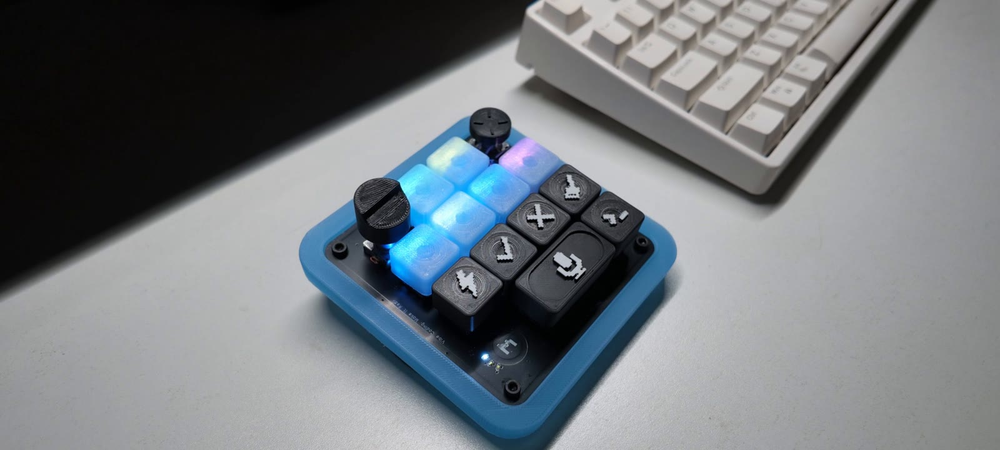
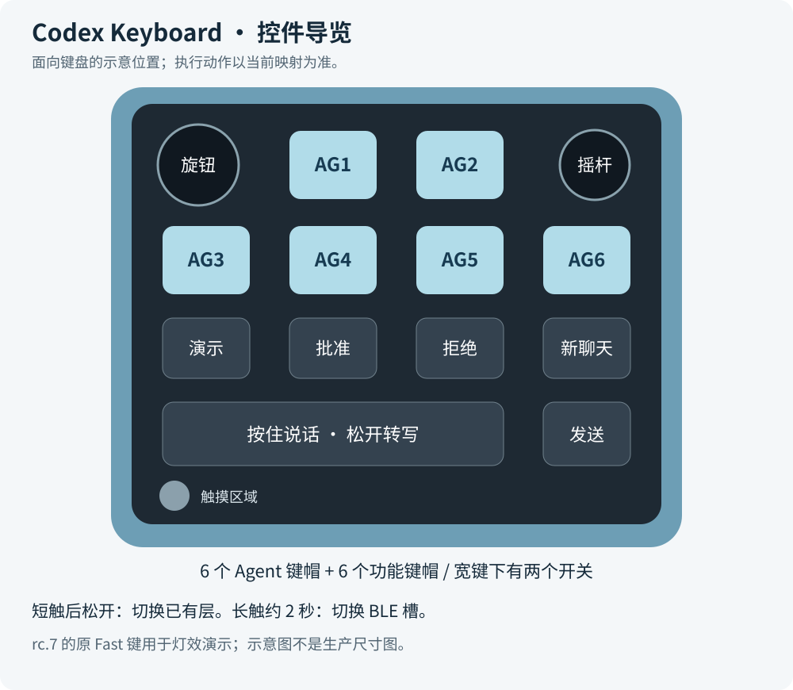
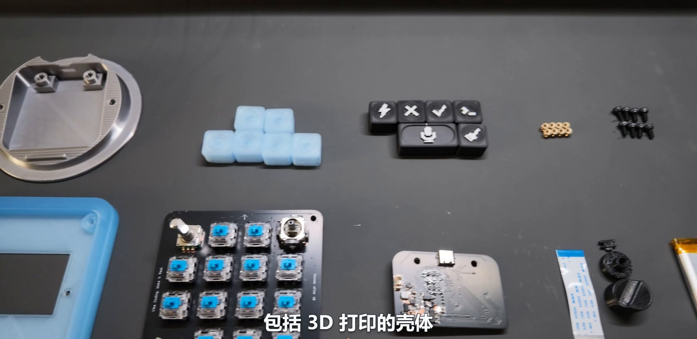
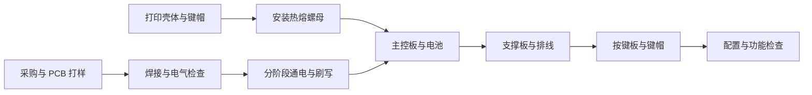
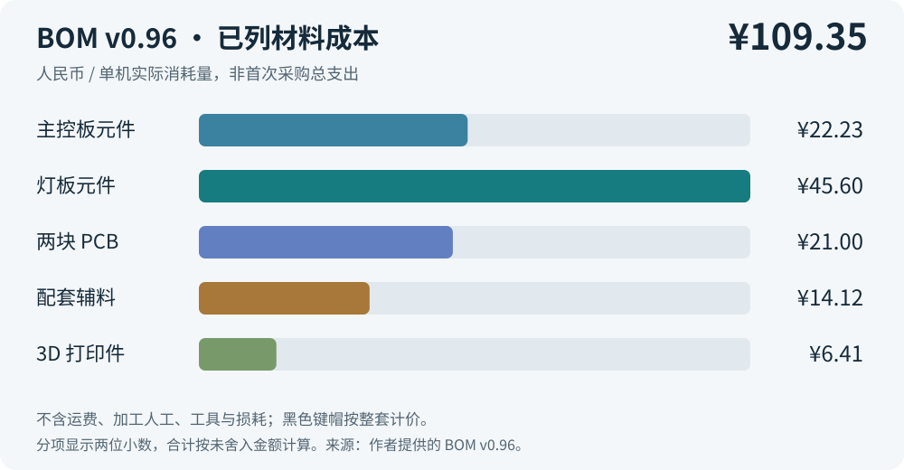
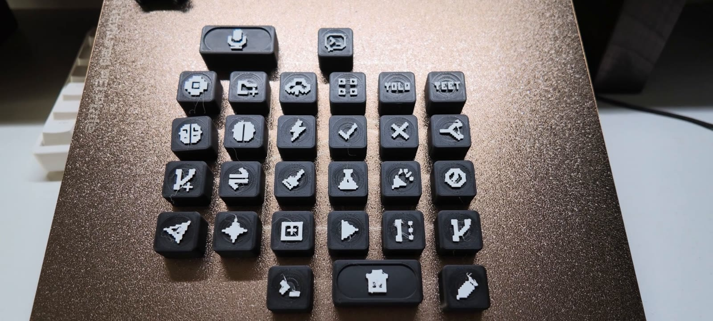

# Codex Keyboard

**把聊天切换、Agent 状态、语音输入和常用操作放到手边。**



**完整制作与功能演示：[在哔哩哔哩观看《我逆向复刻了 Codex 键盘，成本只要…》](https://b23.tv/TivtklJ)**

Codex Keyboard 是一款参考 [Codex Micro](https://worklouder.cc/codex-micro) 制作的 DIY 桌面控制键盘。它采用 ESP32-S3、双 PCB 和 3D 打印结构，用六颗 Agent 键、功能键、旋钮、摇杆与触摸输入，配合 Codex 桌面端和 Work Louder Input 使用。

本项目分享硬件工程、材料清单、打印工程、固件源码和刷写包，希望让想动手做的人能从零件走到成品。按 **BOM v0.96 已列物料**计算，单机材料参考成本为 **¥109.35**；这是按实际消耗量核算的参考值，不是首次采购的总支出。费用范围见[成本说明](docs/cost.md)。

*A DIY desktop controller inspired by Codex Micro, built with an ESP32-S3, custom PCBs and 3D-printed parts. Hardware files, BOM, print projects, firmware source and installation guides are included.*

## 从这里开始

| 你想做什么 | 打开这里 |
| --- | --- |
| 看功能、了解日常操作 | [使用说明与按键示意](docs/usage.md) |
| 买齐零件、估算成本 | [BOM v0.96](hardware/Codex_Keyboard_开源BOM_v0.96.xlsx) · [成本与采购规格](docs/cost.md) |
| 制作 PCB、核对接线 | [硬件说明](docs/hardware.md) · [嘉立创 EDA 工程](hardware/ProPrj_Codex_key_2026-10-20_10-08-15_2026-10-22.epro) |
| 打印底座、支撑板和键帽 | [打印文件与参数](docs/printing.md) |
| 按步骤组装 | [图文制作流程](docs/assembly.md) |
| 给新板烧录固件 | [刷写与首次启动](docs/flashing.md) |
| 修改源码或排查兼容问题 | [固件开发说明](docs/development.md) |
| 查看视频章节和图片来源 | [视频导览](docs/video-guide.md) |

## 它能做什么

| 控件或功能 | 用途 |
| --- | --- |
| 六颗 Agent 键 | 对应六个聊天入口，显示主机下发的状态颜色；视频演示双击将聊天窗口置前 |
| 可更换图案的功能键帽 | 根据自己的映射选择批准、拒绝、新建聊天等图案 |
| 宽麦克风键与发送键 | 按住说话，松开等待转写，再按旁边的独立键发送 |
| 旋转编码器与按压 | 操作桌面端选项，例如浏览、选择模型推理强度 |
| 双轴摇杆与按压 | 触发桌面操作，或在 Input 中设置方向动作 |
| 触摸输入与多层配置 | 短触后松开切换已配置的层；可为剪辑、建模等软件建立不同布局 |
| USB 与 BLE | USB 连接；蓝牙保存三个绑定槽位，每次连接一个主机 |
| 内置 INMP441 麦克风 | USB 单声道音频输入；蓝牙模式不传输板载麦克风音频 |
| 按键背光与底部氛围灯 | 13 颗按键 RGB、8 颗底部 RGB，以及 3 颗小状态灯 |



视频展示了聊天切换、灯光、语音和自定义操作。仓库当前固件是 **1.0.0-rc.7 候选版**，功能实现与整机兼容验收分开记录。**原 Fast 键在此版本用于灯效演示**；电量百分比、充电状态、休眠与蓝牙音频不作为支持功能。具体差异见[使用说明](docs/usage.md#当前版本的差异与限制)。

## 从零件到成品





这份教程适合具备基础焊接和万用表使用经验的制作者。主控板包含 0402 等小封装，制作前先看[硬件说明](docs/hardware.md)与[装配检查](docs/assembly.md)。

| 硬件 | 规格 |
| --- | --- |
| 主控 | ESP32-S3-WROOM-1-N16R8，16 MB Flash、8 MB PSRAM |
| PCB | 主控板两层，灯板四层；灯板厚 1.6 mm，主控板厚约 1.6 mm 待核对订单 |
| 按键 | 4×4 矩阵，装配 13 个机械开关；宽键帽下有两个开关 |
| 控制器 | EC11 编码器、双轴模拟摇杆、触摸输入 |
| 板间连接 | 30P、0.5 mm 间距、100 mm 异面 FFC |
| 电池 | BOM 标注单节 3.7 V、850 mAh，商家选项 603443 |
| 固定件 | 8 颗 M3×4×4.5 热熔螺母、8 颗 M3×6 螺钉 |
| 结构 | 丝绸银 PLA 底座、半透明 PLA 支撑板与透光键帽、黑色/白色图案键帽 |

## 材料成本



| 分类 | 单机参考成本（人民币） |
| --- | ---: |
| 主控板元件 | ¥22.23 |
| 灯板元件 | ¥45.60 |
| 两块 PCB | ¥21.00 |
| 配套辅料 | ¥14.12 |
| 3D 打印件 | ¥6.41 |
| **合计，按未舍入数计算** | **¥109.35** |

报价与采购记录时间为 2026-10-29～2026-11-01。作者已确认黑色键帽 ¥0.60 是整套价格，BOM 中的数量“1”按一套理解。费用不含运费、焊接人工、贴片加工、设备折旧、试错损耗和未列辅料；打印完整图案备件套装还应按实际耗材核算。详见[成本说明](docs/cost.md)。

## 打印文件怎么选

从[六盘总工程](3d-print/BambuStudio_六个打印盘/OPENKEY_六盘总工程.3mf)开始，可一次查看底座、支撑板、透明键帽、黑色键帽、图案键帽和旋钮/摇杆帽。只补打某一类零件时，使用目录中的 `01`～`06` 单盘文件。

总工程保存的配置是 Bambu Lab P2S / 0.4 mm 喷嘴、0.12 mm 层高、20% 填充、关闭支撑与熨烫。换打印机或耗材时，应在 Bambu Studio 重新检查并切片。这些是文件内保存值，不代表全部机器都已经验证。更多信息见[打印说明](docs/printing.md)。



## 当前发布内容

```text
hardware/               嘉立创 .epro 工程、新版 BOM 与历史成本表
3d-print/               Bambu Studio 六盘总工程与单盘文件
firmware/codex-micro/   1.0.0-rc.7 固件源码
firmware/releases/      dev-f9b32206ae2b 刷写包
tools/firmware/         构建、维护、备份与检查脚本
docs/                   制作、打印、刷写、使用和成本说明
docs/images/            视频实物抽帧与说明图
```

图片来自作者提供的制作演示视频，时间点见[视频导览](docs/video-guide.md)。原始视频未放入 Git 仓库。

## 为什么做这个项目

这个项目起点很简单：想把喜欢的桌面控制器做出来，并让复刻成本更容易接受。外壳、支撑板和键帽用 3D 打印制作，电路和固件在与 Codex 的反复协作中逐步完成，再通过焊接、装配和实际使用修正设计。

对作者而言，AI 的意义也在这里：让以前因为编程、建模门槛而搁置的想法，有机会变成手边可以使用的东西。希望这些资料能帮助更多人享受自己动手创造的过程。

## 反馈、参考与许可

复刻遇到问题，请在 [Issues](https://github.com/doubleZ-dev/codex-keyboard/issues) 中附上 PCB/固件版本、连接方式、操作步骤和清晰照片；涉及日志或桌面截图时请先去掉个人内容。

参考产品：[Work Louder Codex Micro](https://worklouder.cc/codex-micro)。配置软件：[Work Louder Input](https://worklouder.cc/input)。本项目是个人 DIY 实现，未由 OpenAI 或 Work Louder 官方发布。

硬件、结构与固件的正式许可证尚待作者确定。当前发布的文件和第三方名称、图标、参考资料应分别核对其适用许可。仍需补充的复刻信息见[资料完善清单](docs/reproduction-notes.md)。
