# 制作与组装

[返回项目首页](../README.md) · [打印说明](printing.md) · [刷写说明](flashing.md) · [使用说明](usage.md)

本文按作者制作视频整理。截图展示制作过程中的实物；照片中的早期打印螺纹与最终采用的热熔螺母可能不同，最终装配以 BOM v0.96 的 8 颗热熔螺母方案为准。

## 1. 备齐零件和工具

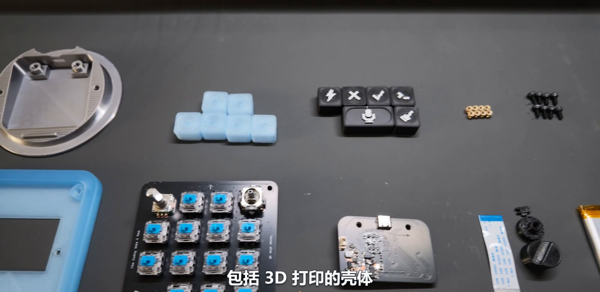

- 主控板、按键/灯板及对应电子元件，型号与数量见 [BOM](../hardware/Codex_Keyboard_开源BOM_v0.96.xlsx)。
- 底座、支撑板、键帽、旋钮帽、摇杆帽及拨动开关帽。
- 30P / 0.5 mm / 100 mm 异面 FFC 排线一条。
- 3.7 V / 850 mAh 单节锂电池，INMP441 模块。
- M3×4×4.5 热熔螺母 8 颗，M3×6 内六角螺钉 8 颗。
- 双面胶用于电池限位。视频使用 3M 胶，其用量与成本未单列进 BOM。
- 万用表、镊子、合适的焊接设备、热熔螺母安装工具和内六角工具。

主控板包含细小贴片器件。视频中的加热与焊接镜头只展示流程，不能代替所用锡膏、PCB 和器件的具体温度曲线。准备加工前核对[硬件文件与制造参数](hardware.md)。

## 2. 焊接主控板

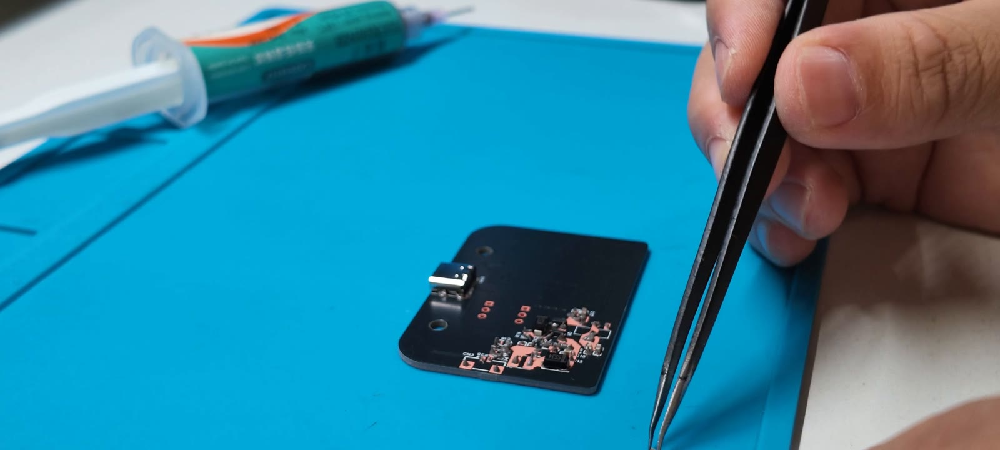

1. 根据原理图、PCB 位号和 BOM 清点元件，确认极性器件、IC 方向及连接器安装面。
2. 视频先完成背面电源相关器件，再焊接正面的主控和其它器件。
3. 每完成一面，检查连锡、虚焊、器件方向以及电源与地之间是否存在持续短路。
4. 核对 USB、电源、板间连接器和麦克风信号网络。电容充电可能产生瞬态读数，不能只凭一次蜂鸣判断整板正常。

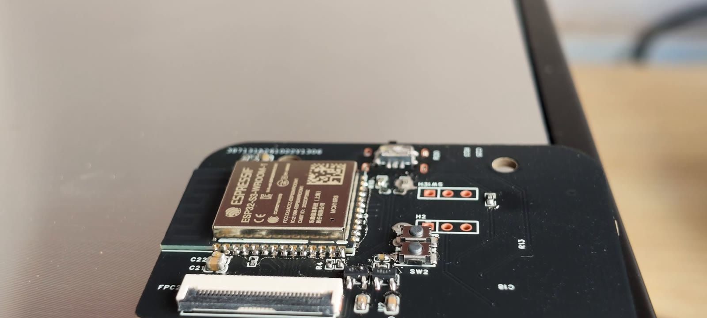

首次检查与 USB 枚举建议在最终封壳前完成，便于返修和接触 BOOT/EN。新板进入运行固件后的验证，需要先按[刷写步骤](flashing.md)完成安装。

## 3. 焊接按键/灯板并连接两板

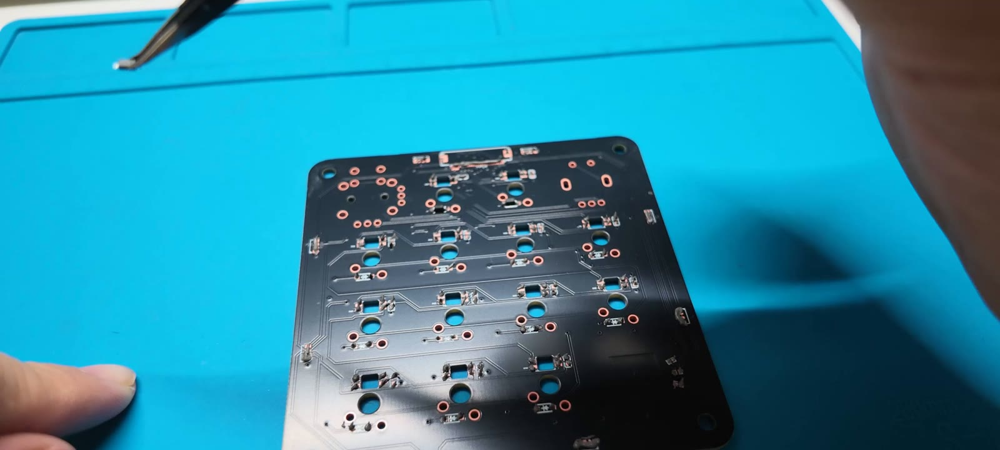

1. 按 PCB 位号贴装矩阵二极管、RGB、状态灯、编码器和摇杆等器件，特别核对二极管和 RGB 方向。
2. 焊接机械开关前先检查板面焊点和相关网络，再完成 13 个开关。
3. 断开 USB 与电池，打开 FFC 连接器锁扣，将排线平直插到位，再锁紧。使用 BOM 指定的异面排线，并按两端触点方向核对。
4. 检查两板相对摆放时排线是否自然弯折，没有拉紧、锐折或夹在支撑柱下。

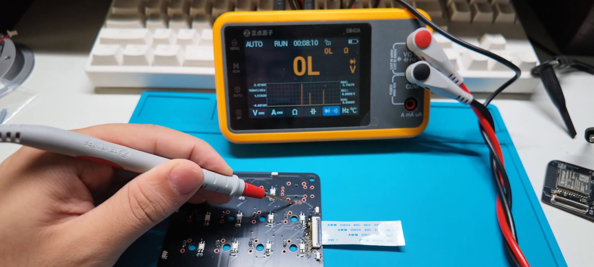

在断电状态做通断与短路检查。若需要拆装 FFC，先断开 USB 和电池，避免带电插拔。

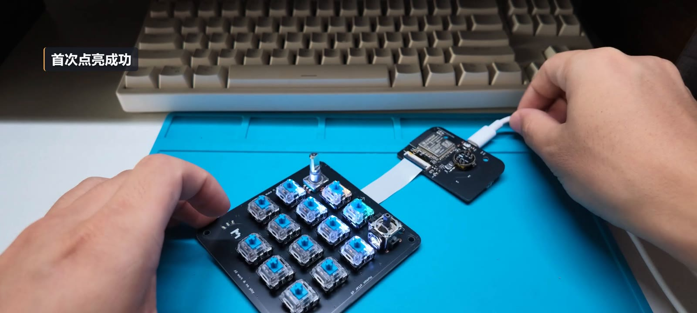

完成电气检查后，再进行分阶段通电。检查主控是否枚举、供电是否稳定、是否异常发热。灯亮不能替代逐键、摇杆、旋钮和音频功能检查。

## 4. 打印结构件与键帽

按[打印指南](printing.md)准备底座、支撑板及所需键帽。视频使用丝绸银 PLA 底座、半透明 PLA 支撑板和透光键帽。图案键帽采用黑底白色顶层的设计。

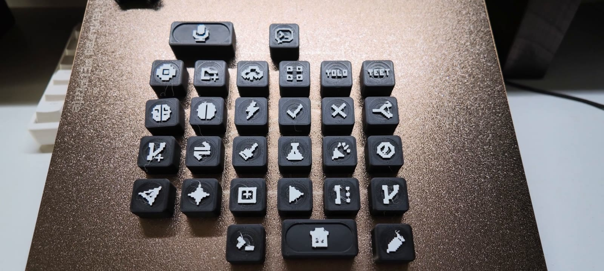

先试装一颗键帽，检查轴体配合和回弹，再打印整套。视频中半透明支撑板开启熨烫后出现白色颗粒，关闭后改善；提供的总工程也关闭了熨烫。

## 5. 安装热熔螺母

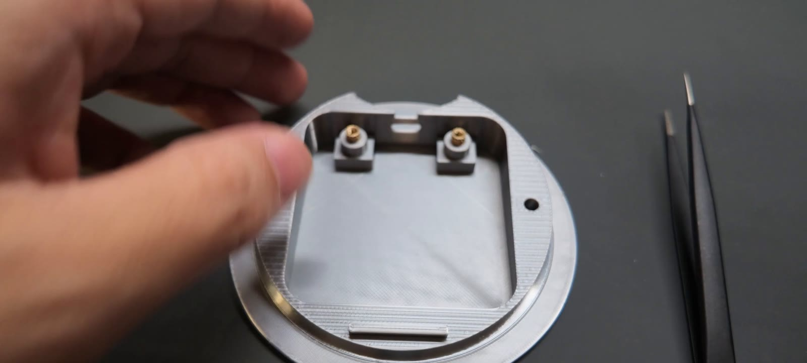

底座和支撑板合计安装 8 颗 M3×4×4.5 热熔螺母。先比对螺母外形与打印孔位，保持螺母轴线垂直于安装面，控制压入深度，冷却后再装螺钉。不要让螺母倾斜、穿透或把周围结构挤裂。

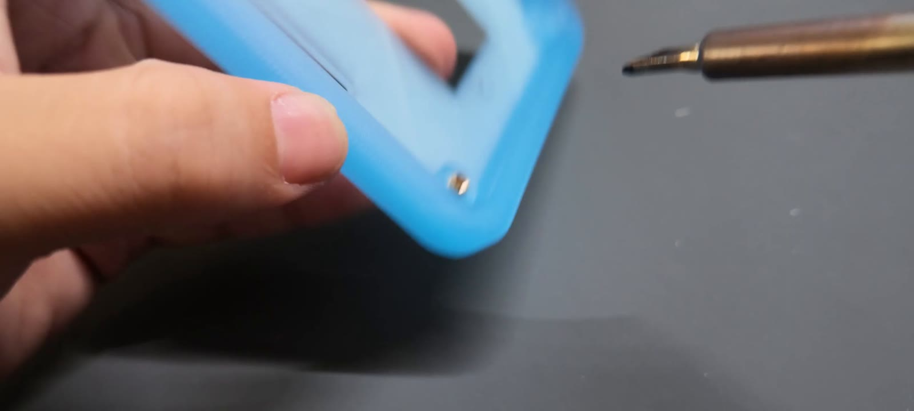

首版直接使用打印螺纹，后续改为热熔螺母以改善定位。螺母商品尺寸的标注顺序应以商品尺寸图核对，不能把 `M3×4×4.5` 的两个尺寸自行互换。

## 6. 固定主控板与电池

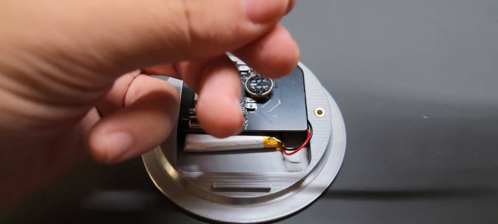

1. 在断电状态把主控板放入底座，对齐固定孔与接口开口，检查没有顶住焊点。
2. 将电池放入对应区域，用双面胶限位。电池不能被螺钉、PCB 锐边或外壳挤压。
3. 核对电池正负极与原理图连接器定义后再接线。相同外形的插头也可能使用不同线序。
4. 布置排线和麦克风线束，给上层支撑板留出安装空间。

麦克风信号引脚与固件 GPIO 见[硬件说明](hardware.md#麦克风接线)。视频没有清晰展示麦克风模块的完整供电接线，安装时需对照原理图及实际模块标记。

## 7. 安装支撑板、按键板与键帽

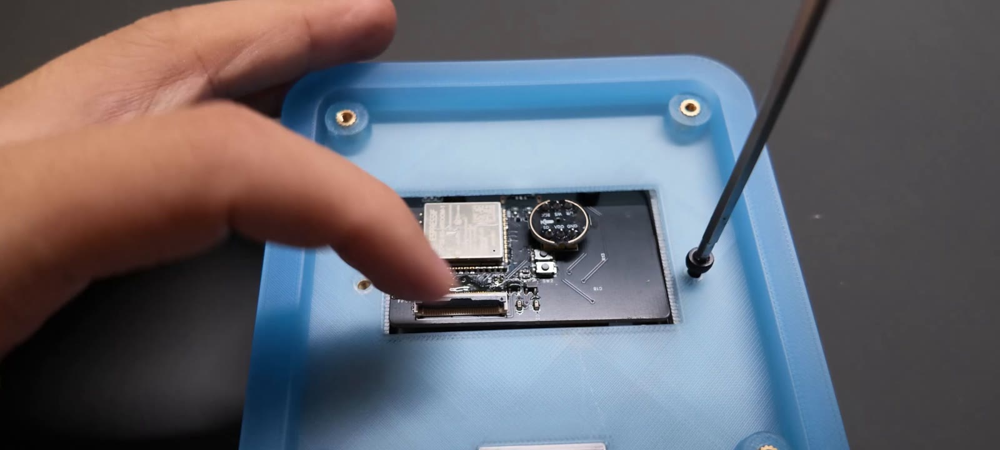

放上支撑板并对齐安装孔。先让所有螺钉少量啮合，再逐步拧紧，避免一角先锁死导致错位。每一步都检查排线、电池线和 USB 开口没有被夹住。

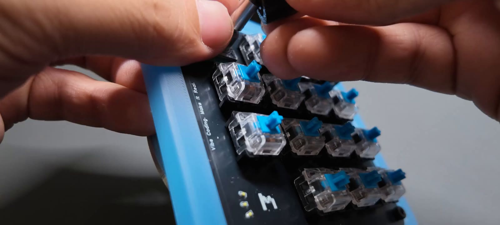

安装按键板，检查摇杆、编码器及开关活动空间。使用 BOM 中的 M3×6 螺钉；如更换长度，需先确认不会接触电池或穿出结构。

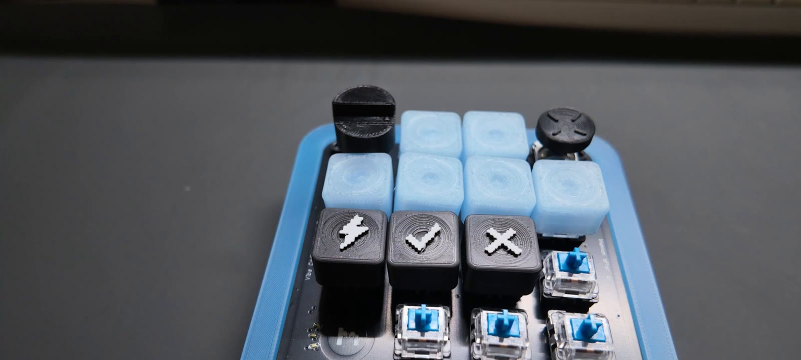

装上六颗透光 Agent 键帽、功能键帽、宽麦克风键帽、独立发送键帽、旋钮帽和摇杆帽。宽键帽下有两个开关，安装后确认两侧均能回弹。面板图案可以根据自己的软件配置更换。

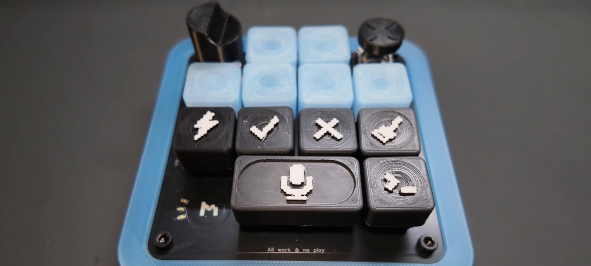

## 8. 首次使用检查

- [ ] USB 数据线连接正常，主机可识别设备。
- [ ] 固件启动后先松开摇杆至少 2 秒，再测试归中与四方向。
- [ ] 所有键帽均能回弹，宽键没有卡滞。
- [ ] 旋钮双向转动、旋钮按压和摇杆按压工作正常。
- [ ] 短触切层在至少两个已配置层之间生效。
- [ ] Agent 键能操作聊天，状态灯能随主机更新。
- [ ] USB 下选择板载麦克风后，能录入、转写并单独发送。
- [ ] 若使用蓝牙，单独检查配对、断线重连和只用电池冷启动。

这些是复刻后的检查项目，不代表每项都已在所有主机平台完成验收。操作方法和固件限制见[使用说明](usage.md)。
