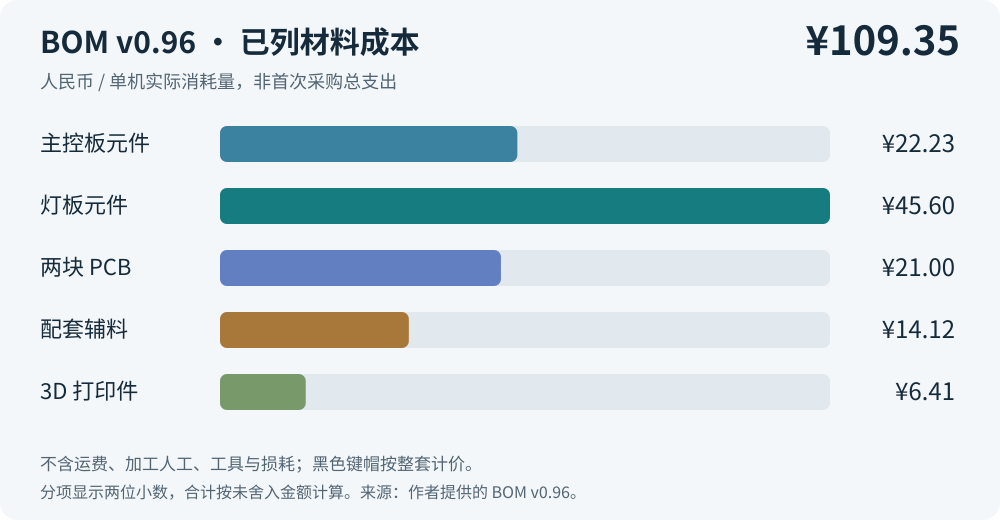

# 成本与采购

[返回项目首页](../README.md) · [下载 BOM v0.96](../hardware/Codex_Keyboard_开源BOM_v0.96.xlsx)

## 参考成本是多少

根据用户提供的 **BOM v0.96 / 2026-11-01**，已列物料的单机材料成本为 **¥109.348385，约 ¥109.35**。视频口播中的“约 109 元”与这一参考值对应；仓库早期使用过约 113 元的成本口径，新文档以 v0.96 为准。

| 分类 | 未舍入金额（元） | 展示金额（元） |
| --- | ---: | ---: |
| 主控板元件 | 22.226715 | 22.23 |
| 灯板元件 | 45.595670 | 45.60 |
| PCB | 21.000000 | 21.00 |
| 配套辅料 | 14.116000 | 14.12 |
| 3D 打印件 | 6.410000 | 6.41 |
| **合计** | **109.348385** | **109.35** |

分项独立四舍五入后相加可能相差 ¥0.01；总计按原始未舍入金额计算。明细来源为工作簿“完整BOM”的数量 G 列、采用单价 V 列及行成本 W 列，“成本总览”用 SUMIF 汇总。

## 价格的统计范围

- 按一台实际消耗数量乘采用单价，不把整包采购支出直接算作单机用量。
- ESP32-S3 采用作者实购价 ¥14.20；其余 38 类电子料沿用 2026-10-29 的立创报价。
- 两块 PCB 分别按主控板 ¥3、灯板 ¥18 计。
- 不包含运费、焊接人工、贴片服务、工具和设备折旧、试错损耗、未列附件。
- 电子元件可能有起订量，首次下单金额通常高于单机已消耗材料成本。

**黑色键帽按整套计价：**作者于 2026-11-02 确认，黑色键帽 ¥0.60 是整套价格，BOM 的数量“1”表示一套。原工作簿中“一颗黑色键帽”等文字应按这一补充理解，单机合计不变。双面胶等辅料未单列，因此 ¥109.35 仍是已列材料合计，实际采购另计运费、起订量与辅料。原始工作簿按提供时内容保留，这里记录更正口径。

完整的 32 个图案键帽是一组可更换备件，不能直接视为单机必装数量；打印整个套装、换色冲刷和备用件会增加成本。

## 主要采购规格

| 部件 | 数量 | 当前记录 |
| --- | ---: | --- |
| 主控模块 | 1 | ESP32-S3-WROOM-1-N16R8，注意 Flash/PSRAM 型号 |
| 机械开关 | 13 | CPG151101D13；以 PCB 封装和键帽配合核对 |
| 编码器 | 1 | EC11E18244A5 |
| 摇杆 | 1 | RKJXV122400R，10 kΩ；BOM 封装名称含 RKJXV1224005，替换前核对尺寸和引脚 |
| 电池 | 1 | 3.7 V / 850 mAh，商家选项 603443，¥8.50 |
| 热熔螺母 | 8 | M3×4×4.5，40 个 ¥3.90，单机 ¥0.78 |
| 螺钉 | 8 | M3×6 内六角圆柱头，50 个 ¥2.60，单机 ¥0.416 |
| 麦克风模块 | 1 | INMP441，作者采购国产芯片、不焊接版本，¥4.00 |
| FFC | 1 | 30P、0.5 mm 间距、100 mm、异面，5 条 ¥2.10，单机 ¥0.42 |

作者补充的 PCB 参数：主控板为两层板，厚度约 1.6 mm（需再核对订单）；灯板为四层板、1.6 mm。原表的“待补采购资料”工作表尚未包含这次补充，制造信息以[硬件说明](hardware.md)的更新为参考。

电池的保护规格、插头和线序仍需按实物核对；不能仅凭型号文字或线色判断。部分商品链接和附件用量仍待补充。

工作簿含成本总览、完整 BOM、待补采购资料和开源说明四个工作表。完整 BOM 中提供元件位号、制造商型号和立创链接，实际价格与供货状态请在采购时重新查询。

## 版本关系

`hardware/` 内的 `Codex_Micro_整机成本_含3D打印件_2026-10-29.xlsx` 是早期成本表，为保留原发布内容暂存。**采购与本次 README 使用 `Codex_Keyboard_开源BOM_v0.96.xlsx`。**BOM 中个别页标题仍显示 v0.9，以“开源说明”中的 v0.96 和具体物料记录为准。
