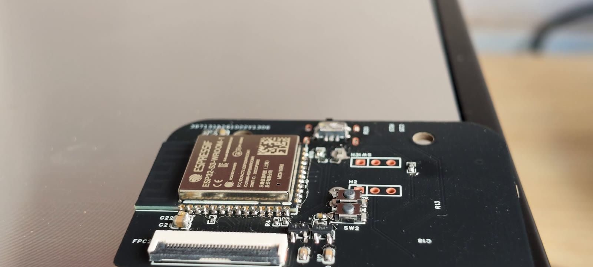
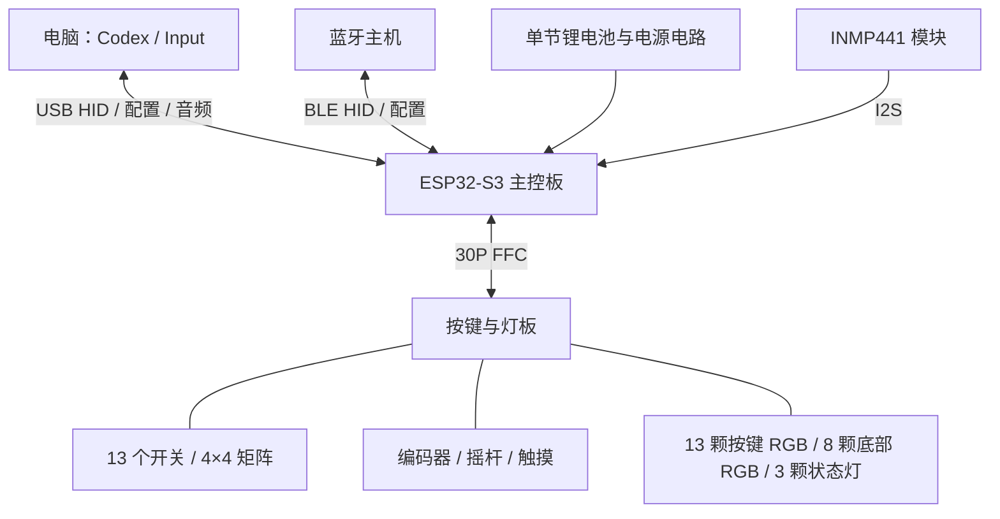
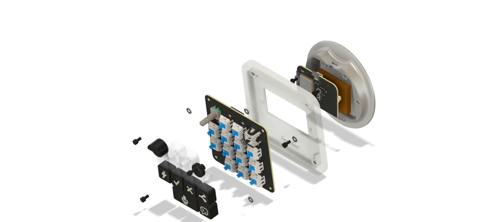

# 硬件与接口

[返回项目首页](../README.md) · [装配教程](assembly.md) · [BOM](../hardware/Codex_Keyboard_开源BOM_v0.96.xlsx)

## 设计文件

在嘉立创 EDA **专业版**导入[工程归档 .epro](../hardware/ProPrj_Codex_key_2026-10-20_10-08-15_2026-10-22.epro)，检查主控板与按键/灯板的原理图、PCB、封装和连接器。采购前按新版 BOM 逐项核对工程里的位号与型号。

当前发布的工程沿用原始文件名，新 BOM 是 v0.96，固件依据 H1 接口定义。打样前需核对关键引脚、板间连接器和电源网络；文件日期不能替代工程版本核对。当前未单独发布 Gerber 包。

作者于 2026-11-02 补充的打样信息：

| 电路板 | 层数 | 厚度 |
| --- | --- | --- |
| 主控板 | 两层 | 约 1.6 mm，作者表示尚需核对订单 |
| 按键/灯板 | 四层 | 1.6 mm |

表面处理与最终生产版本尚待补充，下单前以工程层叠、实际制造订单和装配间隙核对。

## 硬件组成

主控模块采用 ESP32-S3-WROOM-1-N16R8。当前固件使用 USB、BLE 和 I2S；芯片具备 Wi-Fi 能力不代表本项目提供 Wi-Fi 功能。

## 固件使用的 GPIO

以下直接来自 [`board_definition.h`](../firmware/codex-micro/components/fw_foundation/include/board_definition.h)，用于对照原理图。它不是从视频画面推定的焊接位置图。

| 信号 | GPIO |
| --- | --- |
| 矩阵 ROW1～ROW4 | 41、48、47、21 |
| 矩阵 COL1～COL4 | 11、10、9、4 |
| 编码器 A / B / 按压 | 16 / 17 / 18 |
| 摇杆 X / Y / 按压 | 6 / 7 / 15 |
| 触摸 | 5 |
| 按键 RGB / 底部 RGB | 42 / 38 |
| 状态灯 1 / 2 / 3 | 39 / 8 / 40 |
| 电池 ADC | 2 |
| 麦克风 BCLK / DIN / WS | 12 / 13 / 14 |
| USB D− / D+ | 19 / 20 |
| BOOT | 0 |

矩阵有 16 个逻辑位置，安装 13 个机械开关。宽麦克风键帽覆盖两个开关，因此不能仅按键帽数量判断矩阵数量。

## 麦克风接线

当前固件使用 INMP441 **左声道**，I2S Philips stereo32 / 48 kHz 采样并转换为 USB mono PCM16。

| 模块信号 | 固件对应 |
| --- | --- |
| SCK / BCLK | GPIO12 |
| SD（模块输出） | GPIO13，MCU 输入 DIN |
| WS / LRCLK | GPIO14 |
| L/R | GND，选择左声道 |
| VDD、GND | 按原理图和模块实际供电标记接线；本表不推定 PCB 排针顺序 |

视频未清晰展示模块引脚顺序及完整供电线束，不能依据不同商家模块的外观直接套线序。当前板载麦克风只走 USB 音频，不通过 BLE 传输。

## 电源、排线与制造检查

- 电池使用单节 3.7 V、850 mAh，商家选项 603443。保护板参数、插头与极性需按实物和原理图核对。
- FFC 为 30P、0.5 mm、100 mm 异面线。装线前确认两端连接器触点面，不能仅凭蓝色补强片朝向判断。
- 分阶段检查电源与地、USB 网络、焊点和器件极性，完成后再接电池和 USB。
- 主控板厚度需核对订单，表面处理、最终生产版本与电池保护信息尚待补齐，见[资料完善清单](reproduction-notes.md)。

文档不自行推算电池续航，也不把电池 ADC 电压当成准确电量百分比。
