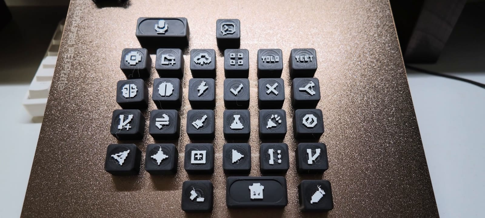

# 3D 打印说明

[返回项目首页](../README.md) · [制作与组装](assembly.md)

## 下载入口

推荐先打开[六盘总工程](../3d-print/BambuStudio_六个打印盘/OPENKEY_六盘总工程.3mf)，查看全部对象与摆盘，再按需打印。文件格式为 Bambu Studio `.3mf` 工程，内含模型和配置。

| 单盘文件 | 内容与用途 |
| --- | --- |
| [01_底座.3mf](../3d-print/BambuStudio_六个打印盘/01_底座.3mf) | 底座 |
| [02_支撑板.3mf](../3d-print/BambuStudio_六个打印盘/02_支撑板.3mf) | 支撑板 |
| [03_六个透明键帽.3mf](../3d-print/BambuStudio_六个打印盘/03_六个透明键帽.3mf) | 六个 Agent 透光键帽 |
| [04_七个纯黑键帽.3mf](../3d-print/BambuStudio_六个打印盘/04_七个纯黑键帽.3mf) | 纯色键帽备选盘；按实际布局选择数量 |
| [05_三十二个图案键帽.3mf](../3d-print/BambuStudio_六个打印盘/05_三十二个图案键帽.3mf) | 用于更换映射的图案键帽套装 |
| [06_旋钮帽和摇杆帽.3mf](../3d-print/BambuStudio_六个打印盘/06_旋钮帽和摇杆帽.3mf) | 旋钮、摇杆等小配件；打印前查看盘内对象 |

截至 2026-11-02，目录中的五个 `OPENKEY_六盘总工程*.3mf` 文件经 SHA-256 比较完全相同，散列为 `67ceb917700d456dec13220c23b210ea21afdc6ede2e7e18f94ae93b340c4333`。不同文件名目前不代表不同模型版本，使用上面无后缀说明的总工程即可。

## 文件中保存的配置

以下读取自总工程的 `Metadata/project_settings.config`，用于帮助检查打开的配置是否一致。

| 项目 | 保存值 |
| --- | --- |
| 打印机预设 | Bambu Lab P2S |
| 喷嘴 | 0.4 mm |
| 层高 / 首层层高 | 0.12 mm / 0.20 mm |
| 壁数 | 2 |
| 稀疏填充 | 20% |
| 支撑 | 关闭 |
| 熨烫 | 关闭 |
| 耗材类型 | PLA |

单个对象、打印盘可能有局部设置，切片前仍需逐盘查看。更换打印机、喷嘴或材料后重新切片，检查模型范围、悬空、壁厚和颜色分配。文件内保存的预设不代表每种设备都完成过实打验证。

## 材料与颜色

| 零件 | 作者使用的材料 |
| --- | --- |
| 底座 | 丝绸银 PLA |
| 支撑板与六颗透明键帽 | 半透明 PLA；视频中呈蓝色透光效果 |
| 纯黑键帽、旋钮帽、摇杆帽、拨动开关帽 | 黑色 PLA |
| 图案键帽 | 黑底与白色图案顶层 |

总工程中的耗材颜色值是预设，不等于你已装入的真实耗材。按实际料盘重新分配颜色，半透明材料也应使用合适的耗材配置。

## 先试配，再批量打印

1. 在 Bambu Studio 打开工程，确认已切换到自己的打印机与喷嘴。
2. 先试打一颗键帽和一个孔位相关零件，验证轴体配合、螺母孔、USB 开口和螺钉沉孔。
3. 检查切片预览中的图案、换色层与内部结构，再打印整盘。
4. 打印完成后清理接口和孔位残留，按[组装教程](assembly.md)装入热熔螺母。

视频记录了半透明支撑板开启熨烫后出现白色颗粒的情况，关闭后表面改善。先保留工程中关闭熨烫的设置。

图案设计把白色放在顶部，视频演示只需一次换色；具体换色层应从当前切片预览核对，不能给所有机器套用一个固定层号。

## 与成本表的关系

BOM 中的打印材料成本是当前已列结构件的使用量口径。打印整套 32 个图案键帽、备件、换色冲刷和失败件会产生额外耗材，详见[成本说明](cost.md)。当前仓库提供 `.3mf`，没有另行发布独立 STL/STEP 包。
