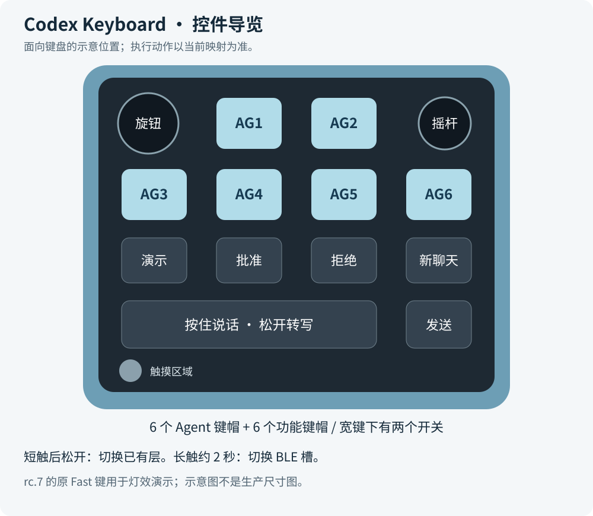
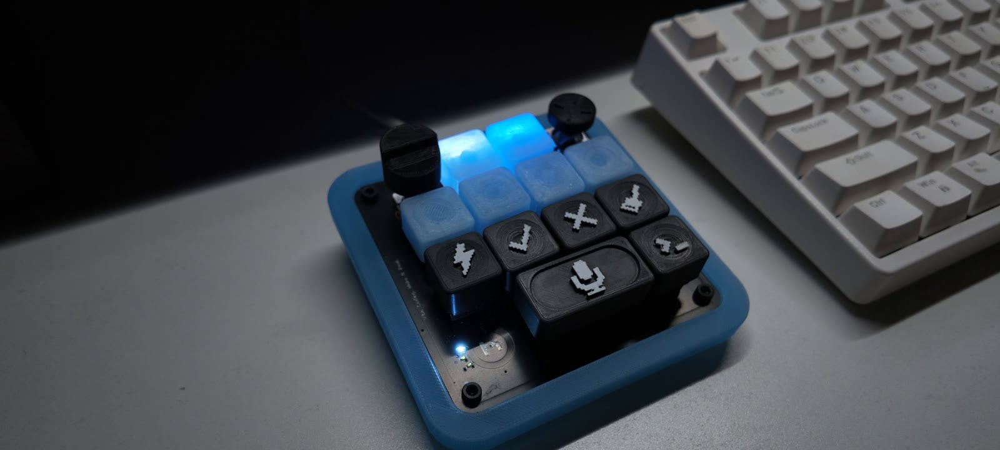

# 使用说明

[返回项目首页](../README.md) · [首次刷写](flashing.md) · [制作流程](assembly.md)

适用仓库当前 **1.0.0-rc.7 / dev-f9b32206ae2b** 固件。本文结合作者演示视频、当前固件与已有实机记录编写；按键执行结果同时取决于当前配置层和桌面应用版本。

## 首次连接

1. 完成[刷写与首次启动](flashing.md)，先用支持数据传输的 USB 线连接。
2. 开机后松开摇杆至少 2 秒，让启动中心校准完成。不要握住摇杆上电。
3. 打开 Codex 桌面端，检查设备识别和聊天操作。如果没有自动识别，先检查系统 USB 枚举、当前配置和固件版本。
4. 需要自定义快捷键时，从 [Work Louder 官方页面](https://worklouder.cc/input)下载 Input。官方将其作为按键、旋钮和多击动作的配置工具；本项目对具体版本的兼容性仍需在实际环境核对。

Codex 聊天操作与语音转写由主机软件处理，键盘不在 MCU 内运行聊天模型。

## 控件在哪里

示意图是功能导览，不是 PCB 尺寸图。图案键帽可以更换，所以以当前软件映射为准。

| 控件 | 使用方法 |
| --- | --- |
| 上方六颗 Agent 键 | 对应六个聊天入口；视频演示双击后将目标聊天窗口置前 |
| 中间一排四个功能键 | 根据当前映射执行批准、拒绝、新建/分支等动作；**本版最左侧原 Fast 键保留为灯效演示** |
| 底部宽麦克风键 | 按住说话，松开结束录音；宽键下有两个开关，日常作为一个宽键使用 |
| 麦克风键旁的独立 Codex 键 | 等转写文字进入输入框后，再按下发送 |
| 左上旋钮 | 转动浏览选项，短按选择；具体菜单取决于桌面端 |
| 右上摇杆 | 当前记录中上/右/下/左为规划模式、前进、侧栏、后退；可自定义 |
| 摇杆按压 | 当前记录是媒体播放/暂停，不是发送键 |
| 触摸区域短触后松开 | 循环切换已经存在的层 |
| 触摸长按约 2 秒 | 切换到下一 BLE 槽；空槽开启配对窗口 |

Agent 双击置前属于桌面端对事件的处理，不能仅凭固件按键事件就保证所有应用版本的窗口行为。菜单项和按钮名称可能随桌面端版本变化。

## Agent 状态灯

| 颜色 | 含义 |
| --- | --- |
| 白色 | 聊天空闲 |
| 蓝色 | 思考/工作中 |
| 绿色 | 已完成，有待查看的更新 |
| 琥珀色/黄色 | 需要批准或回复 |
| 红色 | 错误；特定菜单中也可能表示取消 |
| 熄灭 | 可能未分配聊天，也可能是主机/图层关闭了灯光 |

状态由桌面端下发。灯效演示模式也能显示这些颜色，因此看到颜色本身并不能证明当前聊天正处于相应状态。要检查真实状态反馈，请先退出演示，再观察主机任务与按键灯是否同步。

## 语音输入与发送

1. 用 USB 连接键盘，在主机或应用的音频输入设置中选择 **Codex Micro INMP441**。
2. 在目标聊天中按住宽麦克风键说话，松开结束录音。
3. 等待转写文字显示，检查内容，再按旁边独立的 Codex 键发送。

USB 板载麦克风为 48 kHz 单声道 PCM16。只用蓝牙时，按键仍可控制主机录音，但要使用主机或其它麦克风；本固件不提供蓝牙音频。

录音与固件维护互斥，升级前结束录音并关闭占用设备的工具。灯光变化不能代替录音电平或转写结果检查。

## 在 Input 配置不同软件的操作

1. USB 连接，打开 Input 并选择设备与目标 Profile/Layer。
2. 为按键、旋钮或摇杆设置所需动作，保存/提交配置。
3. 在目标软件中实际测试，再更换对应图案的实体键帽。
4. 建立至少两个层后，用触摸短触后松开切换。只有一层时，短触不会自动生成新层。

固件支持六个 Profile，每个最多六层；日常触摸循环的是当前配置中已经存在的层。宏、多击、Smart Actions 和应用匹配需要先配置，不能仅凭烧录固件就获得某套剪辑/游戏预设。

先从一个普通快捷键验证配置写入，再添加复杂动作。主机上的命令、应用启动等 Smart Actions 由 Input 执行。

## USB 与蓝牙

默认 USB 连接优先，拔下后可使用当前 BLE 槽。蓝牙可保存三个独立绑定，但同一时刻连接一个主机；广播名称为 `Codex Micro #1`、`#2`、`#3`。

触摸长按约 2 秒切下一槽，空槽开放约 60 秒配对窗口。到系统蓝牙设置选择对应槽位的名称完成配对。若使用已绑定槽位，需要检查目标主机是否仍保存绑定。

三颗小状态灯在 BLE 模式下指示槽位，配对窗口会闪烁。常亮只表示所选槽位，连接状态仍需由主机和实际按键输入确认。USB 模式下小灯用于表示层，不要求三颗全部亮。

蓝牙跨平台重连、只用电池冷启动和桌面端 Agent 行为仍属于需要逐环境回归的项目。出现切换问题时，先通过 USB 验证基础操作，再单独测试蓝牙。

## 灯效演示与低电提醒

当前 rc.7 的原 Fast 键用于演示：单击开始/退出灯效循环，为区分双击约延迟 350 ms；双击进入逐颗累积亮灯。退出后恢复主机或图层灯光，重启不会自动播放。

检测到低电压时，三颗小状态灯同步闪烁。固件以滤波后电池电压连续约 2 秒不高于 3.50 V 触发、连续约 2 秒不低于 3.65 V 恢复。它不等于充电指示，不显示准确电量百分比，也不会自动休眠或关机。

## 当前版本的差异与限制

| 项目 | 当前情况 |
| --- | --- |
| 固件阶段 | 1.0.0-rc.7 候选版，尚未完成全部主机/整机验收 |
| 原 Fast 键 | 本版由灯效演示占用，即使配置界面显示原映射，也不执行原桌面 Fast 动作 |
| 电源键 | 使用本项目机械开关；不照搬原版后置按钮的操作 |
| 触摸长按 | 本项目约 2 秒切 BLE 槽，不能直接照搬原版触摸菜单说明 |
| 板载麦克风 | USB 音频，BLE 无音频 |
| 电池/充电 | 只有电压与低电提醒，无准确百分比、在位或充电状态判断 |
| 休眠与节能唤醒 | 当前没有实现 |
| 灯光动画 | 项目实现，不保证与原版逐帧一致 |
| KI_FP 等语义未确认动作 | 当前不宣称支持；提交配置时会拒绝未知语义 |
| 系统兼容性 | 视频与已有记录不能替代 Windows/macOS/Linux 全版本验收 |

## 常见问题

| 现象 | 先检查什么 |
| --- | --- |
| 没有识别设备 | 换支持数据传输的线、检查 USB 枚举与电源网络；新板确认完整烧录四镜像 |
| 按键图案和实际动作不同 | 看当前层和实际映射，特别注意本版 Fast 演示键 |
| 麦克风键只录音、不发送 | 等待转写后按旁边的独立发送键 |
| USB 录不到板载麦克风 | 检查所选音源、系统麦克风权限、INMP441 接线与 L/R；确认不是只用 BLE |
| 触摸后没有变化 | 先确认当前 Profile 中至少有两个已配置层 |
| 灯变色但聊天状态没变 | 退出演示，确认主机连接与当前图层设置 |
| 蓝牙灯亮却无按键输入 | 检查目标主机、槽位、绑定与订阅；小灯不证明连接完成 |
| 摇杆偏移 | 松手重启并等待至少 2 秒，再测试；不要开机时握住摇杆 |

反馈问题时请提供操作系统、桌面软件版本、固件版本、USB/BLE 连接方式和复现步骤。
